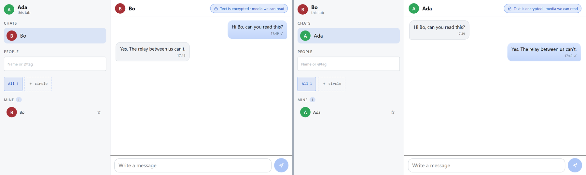

# Masia messenger

[](https://github.com/masia-toots/masia-chat/actions/workflows/ci.yml)

End-to-end encrypted chats between people (MLS, RFC 9420), built so that an AI assistant can be a visible,
opt-in member of a room instead of a silent reader. This repository is the open core of that messenger:
the ports a host implements, the client core with its UI, a relay that delivers ciphertext and cannot read
it, and a playground that runs the whole thing on your machine.

It is **readable first**: the repository carries how it is built (the plan, the decisions, the lessons, the
log), not only the code. Start at [`packages/messenger/CLAUDE.md`](packages/messenger/CLAUDE.md), which says
where everything lives, then [`packages/messenger/docs/context.md`](packages/messenger/docs/context.md) for how
far it is today. The project is pre-1.0.

## What is here

| Directory | What | Licence |
| --- | --- | --- |
| [`packages/contracts`](packages/contracts) | The ports: the only surface the messenger and the relay share with a host, with in-memory fakes and the contract suites that prove an implementation | Apache-2.0 |
| [`packages/messenger`](packages/messenger) | The client: the MLS core, the state of a conversation, the UI core; and the documentation of the whole project | Apache-2.0 |
| [`packages/relay`](packages/relay) | The relay's delivery logic as a library | AGPL-3.0-only |
| [`apps/relay`](apps/relay) | The relay as a process: a Fastify server with its own database | AGPL-3.0-only |
| [`demo`](demo) | The playground: one command, two browser tabs, an encrypted chat through a local relay | Apache-2.0 |

Each directory carries its own `LICENSE`, and the `LICENSE` at the root is the Apache-2.0 text that covers
everything except where a directory says otherwise. The split is deliberate: what other people embed (the
client, the contracts, the playground) is Apache-2.0; the server is AGPL-3.0, so a fork of the relay stays open.
Copyright 2026 Masia Toots.

## Try it in five minutes

You need Docker with Compose v2.

```sh
git clone https://github.com/masia-toots/masia-chat.git
cd masia-chat/demo
docker compose up --build
```

Then open <http://localhost:8080> in two tabs, join with two names, and write. What is encrypted, what the
relay sees, and which shortcuts the playground takes are in [`demo/README.md`](demo/README.md).



## Where it stands

Pre-1.0. Every package is at 0.0.1, and the interfaces will change. The page that tracks this against the code,
with test counts and dates, is [`packages/messenger/docs/context.md`](packages/messenger/docs/context.md).

**Works today**

- The playground: an end-to-end encrypted chat (MLS, RFC 9420) between two tabs, through a relay on your machine.
- The relay keeps ciphertext, public keys and routing metadata. Its schema has no column for message text, and
  it drops envelopes and handshakes after 30 days.
- The client: replies, edits, @-mentions, and a "not sent" line with Retry and Delete that survives a reload.
  The unread count is the number the server keeps, not one the client adds up.
- Devices: signed device lists, a 16-digit approval code, moving the identity key between one person's devices,
  and an operator reset for a lost key, in the contracts, the client crypto and the relay.
- The assistant is a room member everyone can see. It joins only as an `ASSISTANT` device on the operator's
  list, and the add rule is checked both when a commit is sent and when it is received.
- The MLS engine passes interop scenarios against OpenMLS (`pnpm test:interop`, needs Docker), with one pinned
  patch to `ts-mls`. Every port has an in-memory fake and a contract suite.

**Not there yet**

- The room runtime (sessions, enrolment, commits, one writer per room) is not in the package. `createMessenger`
  holds the ports and nothing more, so the playground carries its own runtime.
- There is no screen or flow here for adding a device or moving the identity key, and no run on a real phone yet.
- The relay is a mailbox over HTTP: clients poll, and there is no push channel. Deployment, TLS and backups are
  yours to decide. The relay checks tokens; minting them is the host's job.
- Pictures and files do not go through the encrypted path yet.
- Calls are not in this repository. The first host has one-to-one audio calls, built outside it; moving them
  in is separate work, not started.
- `ts-mls` is young and has one maintainer, and neither it nor this code has had an outside security audit.
  The open design questions (who signs a minor's device list, how people verify each other, what a message is
  bound to, how much to trust a web device) are listed in `context.md`.

## Develop

```sh
pnpm install
pnpm test                               # every package's unit and contract suites
pnpm typecheck
pnpm lint
pnpm boundary                           # who may import whom, resolved to files
pnpm docs:check                         # every relative link resolves, no forbidden token in the docs
pnpm forbidden-tokens                   # nothing private anywhere in what is published
```

The relay's database suites need a Postgres and are skipped without one; set `RELAY_TEST_REQUIRE_DB=1` to make
an unreachable database a failure instead (CI does).

How to contribute is in `CONTRIBUTING.md` (GitHub offers it on every new issue and pull request); how changes are made (plan first, contracts as the
condition for a merge, security review before crypto code) is in
[`packages/messenger/docs/protocol.md`](packages/messenger/docs/protocol.md). The boundary law, that the client
and the relay import only the contracts and never each other, and that the playground imports only the client
and the contracts, is enforced twice: by the lint config and by `pnpm boundary` at the root. CI
(`.github/workflows/ci.yml`) runs both, and every gate above.

## Security

A vulnerability goes through the private route in [SECURITY.md](SECURITY.md), never into a public issue.

## Maintainers

[MAINTAINERS.md](MAINTAINERS.md).
